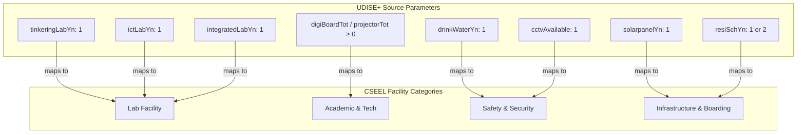

# UDISE+ to CSEEL Facility Mapping Master Specification

> **Document Version:** 1.0  
> **Status:** Production Standard  
> **Author:** CSEEL Engineering Team  
> **Target Models:** UDISE+ Govt Portal API, Supabase `udise_private_schools`, CSEEL School Profile & Filter UI  

---

## 1. Overview & General Mapping Logic

In the Government UDISE+ schema, facility attributes follow strict conventions:
- **Binary Flags:** `1 = Yes (Available)`, `2 = No (Not Available)`, `0 = Not Applicable / Unknown`.
- **Numeric Fields:** Totals of functional rooms, units, boards, or devices (e.g., `digiBoardTot`, `projectorTot`, `clsrmsInst`). Any value `> 0` translates to facility presence (`available: true`).
- **Textual Fallbacks (UP / State Datasets):** Fields containing `'Yes'` or `'No'` (e.g., `atal_stem_lab: "Yes"`, `ro_water: "Yes"`).

When a school profile is loaded, these verified parameters are mapped to CSEEL's 6 core facility categories:
1. **Lab Facility**
2. **Academic**
3. **Sports & Fitness**
4. **Safety & Security**
5. **Infrastructure & Boarding**
6. **Extracurricular**

---

## 2. Category-Wise Facility Mapping Table

### Category 1: Lab Facility

| CSEEL Facility Name | CSEEL Internal Key | UDISE+ API Field (`/school/facility`) | Supabase Column | Value Condition | UI Tag / Display |
| :--- | :--- | :--- | :--- | :--- | :--- |
| **ATL Tinkering Lab** | `atl_tinkering_lab` | `tinkeringLabYn`, `atlLabYn` | `atal_stem_lab` | `== 1` or `'Yes'` | **Atal Tinkering Lab** badge with verified checkmark |
| **Robotics Lab** | `robotics_lab` | `tinkeringLabYn`, `stemLabYn` | `atal_stem_lab` | `== 1` or `'Yes'` | Active under Labs when ATL is present |
| **Composite Lab** | `composite_lab` | `integratedLabYn`, `compositeLabYn` | `integrated_science_lab` | `== 1` or `'Yes'` | Available for Senior / High Secondary |
| **Science Lab** | `science_lab` | `integratedLabYn`, `scienceLabYn` | `integrated_science_lab` | `== 1` or `'Yes'` | Standard Science Lab |
| **Physics Lab** | `physics_lab` | `integratedLabYn`, `physicsLabYn` | `physics_lab` | `== 1` or Secondary/Sr Sec | Enabled if Integrated Lab or dedicated lab |
| **Chemistry Lab** | `chemistry_lab` | `integratedLabYn`, `chemLabYn` | `chem_lab` | `== 1` | Enabled if Integrated Lab or dedicated lab |
| **Biology Lab** | `biology_lab` | `integratedLabYn`, `bioLabYn` | `bio_lab` | `== 1` | Enabled if Integrated Lab or dedicated lab |
| **Experiential Science Lab** | `experiential_science_lab`| `integratedLabYn` | `integrated_science_lab` | `== 1` | Hands-on STEM learning |
| **Computer Lab** | `computer_lab` | `ictLabYn`, `compLabYn` | `computer_ict_lab` | `== 1` or `totLaptop + totDesktop > 0` | Functional ICT & Computer Lab |
| **Language Lab** | `language_lab` | `languageLabYn` | `language_lab` | `== 1` | Specialized speech & language lab |
| **Math Lab** | `math_lab` | `mathLabYn` | `math_lab` | `== 1` | Practical mathematics lab |

---

### Category 2: Academic & Tech

| CSEEL Facility Name | CSEEL Internal Key | UDISE+ API Field (`/school/facility`) | Supabase Column | Value Condition | UI Tag / Display |
| :--- | :--- | :--- | :--- | :--- | :--- |
| **Smart Classes** | `smart_classrooms` | `smartClassYn`, `digiClassYn` | `working_smart_boards` | `== 1` or `digiBoardTot > 0` or `projectorTot > 0` | Digital Interactive Classrooms |
| **Library** | `library` | `libraryYn`, `libraryAvailable` | `library` | `== 1` or `libBookTot > 0` | Central reading library |
| **E-Library** | `e_library` | `dgtlContYn`, `ictDigtlDevTot` | `e_library` | `== 1` or `ictDigtlDevTot > 0` | Digital learning repository |
| **AV / Media Room** | `av_media_room` | `projectorTot`, `avRoomYn` | `av_room` | `projectorTot > 0` or `== 1` | Audiovisual screening room |
| **Career Counseling** | `career_counseling` | `counselorYn`, `guidanceYn` | `career_counseling` | `== 1` | Pastoral care & student guidance |
| **VR/AR Learning** | `vr_ar_learning` | `vrLabYn` | `vr_lab` | `== 1` | Advanced immersive learning |
| **Competitive Exam Coaching** | `competitive_coaching` | `coachingYn` | `coaching` | `== 1` | In-house preparation programs |

---

### Category 3: Sports & Fitness

| CSEEL Facility Name | CSEEL Internal Key | UDISE+ API Field (`/school/facility`) | Supabase Column | Value Condition | UI Tag / Display |
| :--- | :--- | :--- | :--- | :--- | :--- |
| **Playground / Outdoor Sports** | `playground_outdoor_sports` | `playgroundYn`, `playgrndYn` | `playground_available` | `== 1` or `'Yes'` | Outdoor sports grounds |
| **Indoor Games** | `indoor_games` | `indoorGameYn` | `indoor_games` | `== 1` | Badminton, chess, carrom, table tennis |
| **Swimming Pool** | `swimming_pool` | `swimmingPoolYn` | `swimming_pool` | `== 1` | Aquatic sports center |
| **Basketball Court** | `basketball_court` | `playgroundYn` + verified sports | `basketball_court` | `== 1` | Dedicated or marked court |
| **Football Ground** | `football_ground` | `playgroundYn` + large campus | `football_ground` | `== 1` | Regulation grass/turf ground |
| **Gymnasium** | `gymnasium` | `gymYn` | `gymnasium` | `== 1` | Fitness & strength training room |
| **Yoga Center** | `yoga_center` | `yogaYn` | `yoga_center` | `== 1` | Dedicated yoga & meditation area |
| **Running Track / Athletics** | `running_track` | `sportsEquipYn`, `playgroundYn` | `athletics_track` | `== 1` | Track and field facilities |

---

### Category 4: Safety & Security

| CSEEL Facility Name | CSEEL Internal Key | UDISE+ API Field (`/school/facility`) | Supabase Column | Value Condition | UI Tag / Display |
| :--- | :--- | :--- | :--- | :--- | :--- |
| **CCTV Surveillance** | `cctv_surveillance` | `cctvAvailable`, `cctvYn` | `cctv_cameras` | `== '1'` or `== 1` | Campus-wide security cameras |
| **RO Drinking Water** | `ro_drinking_water` | `drinkWaterYn`, `waterPurifierYn` | `ro_water` | `== 1` or `'Yes'` | Treated potable drinking water |
| **Medical Room / Clinic** | `medical_clinic` | `medchkYn`, `medicalCheckupYn` | `medical_checkup` | `== 1` or `'Yes'` | First-aid room with regular doctor checkups |
| **Disabled Friendly / Ramps** | `wheelchair_ramps` | `rampsYn`, `rampsAvailable` | `ramps_available` | `== 1` or `'Yes'` | Wheelchair accessible ramps & handrails |
| **Fire Safety Setup** | `fire_safety` | `fireExtingYn`, `fireSafetyYn` | `fire_extinguishers` | `== 1` or `'Yes'` | Extinguishers & evacuation plans |
| **GPS Enabled Transport** | `gps_transport` | `gpsYn`, `busGpsYn` | `gps_buses` | `== 1` | Real-time vehicle location tracking |
| **Student Tracking App** | `student_tracking` | `parentPortalYn` | `parent_app` | `== 1` | Parent mobile app & attendance alerts |

---

### Category 5: Infrastructure & Boarding

| CSEEL Facility Name | CSEEL Internal Key | UDISE+ API Field (`/school/facility` or `/profile`) | Supabase Column | Value Condition | UI Tag / Display |
| :--- | :--- | :--- | :--- | :--- | :--- |
| **Wi-Fi Campus** | `wi_fi_campus` | `internetYn`, `wifiYn` | `internet_access` | `== 1` or `'Yes'` | High-speed campus network |
| **Air Conditioned Classrooms** | `air_conditioned` | `acClassYn` | `ac_classrooms` | `== 1` | Climate controlled learning spaces |
| **Hostel / Boarding** | `hostel_boarding` | `resiSchYn`, `resiSchDesc` | `residential_school` | `resiSchYn in [1, 2]` or contains `'residential'` | Residential campus facilities |
| **Boys Hostel** | `boys_hostel` | `resiSchYn` | `residential_school` | Residential + `schType in [Co-ed, Boys]` | On-campus residential hostel for boys |
| **Girls Hostel** | `girls_hostel` | `resiSchYn` | `residential_school` | Residential + `schType in [Co-ed, Girls]` | On-campus residential hostel for girls |
| **Auditorium** | `auditorium` | `auditoriumYn` | `auditorium` | `== 1` | Multi-purpose event hall |
| **Cafeteria / Canteen** | `cafeteria` | `canteenYn` | `canteen` | `== 1` | Hygienic dining facility |
| **Mid-Day Meals / Dining** | `mid_day_meals` | `mdmYn`, `kitchenShedYn` | `mid_day_meal` | `== 1` or `'Yes'` | Nutritious dining / meal provision |
| **Solar Power / Green Campus** | `solar_energy` | `solarpanelYn`, `solarPanelYn` | `solar_power` | `== 1` | Eco-friendly solar rooftop / renewable energy |
| **Elevators / Lifts** | `elevators` | `liftYn` | `lifts_elevators` | `== 1` | Multi-story accessibility elevators |
| **Activity Rooms** | `activity_rooms` | `activityRoomYn` | `activity_rooms` | `== 1` | Creative and club activities room |

---

### Category 6: Extracurricular

| CSEEL Facility Name | CSEEL Internal Key | UDISE+ API Field (`/school/facility`) | Supabase Column | Value Condition | UI Tag / Display |
| :--- | :--- | :--- | :--- | :--- | :--- |
| **Art & Craft Studio** | `art_craft_studio` | `artRoomYn` | `art_room` | `== 1` | Fine arts & creative workshop |
| **Music Room** | `music_room` | `musicRoomYn` | `music_room` | `== 1` | Vocal & instrumental music training |
| **Dance Room** | `dance_room` | `danceRoomYn` | `dance_room` | `== 1` | Choreography & dance studio |
| **Theatre / Drama** | `theatre_drama` | `dramaRoomYn` | `drama_theatre` | `== 1` | Drama & stage performance practice |
| **NCC** | `ncc` | `nccYn` | `ncc_cadets` | `== 1` | National Cadet Corps wing |
| **Scouts & Guides** | `scouts_guides` | `scoutYn` | `scouts_and_guides` | `== 1` | Bharat Scouts & Guides wing |
| **Eco Club & Gardening** | `eco_club` | `ecoClubYn` | `eco_club` | `== 1` | Botanical gardens & sustainability drives |

---

## 3. Data Extraction & Fallback Hierarchy

In `src/app/api/udise/standard-profile/route.ts`, the profile builder follows a three-tier cascade:

1. **Government UDISE+ API (`facilityData` & `profile`):**
   - Direct live endpoint fetch from `/school/facility` and `/school/profile`.
   - Highest confidence source.

2. **Supabase Ingested Records (`supabaseData` from `udise_private_schools`):**
   - Matches by 11-digit UDISE code (`udise_code` or `school_id`).
   - Resolves state-specific fields (e.g. `atal_stem_lab`, `integrated_science_lab`, `ro_water`).

3. **Curated Secondary Cache (`schools_database.json`):**
   - Pre-indexed high-precision geocodes (`lat`, `lng`), affiliation numbers, verified phone/emails.

---

## 4. Normalization Rules in Code

```typescript
// Sample implementation in src/app/api/udise/standard-profile/route.ts:

// Atal Tinkering Lab (ATL) & Robotics
if (
  facilityData?.tinkeringLabYn === 1 ||
  facilityData?.tinkeringLabYn === '1' ||
  facilityData?.atlLabYn === 1 ||
  supabaseData?.atal_stem_lab === 'Yes'
) {
  verifiedFacilitiesSet.add('atl_tinkering_lab');
  verifiedFacilitiesSet.add('robotics_lab');
}

// Integrated / Composite Science Lab
if (
  facilityData?.integratedLabYn === 1 ||
  facilityData?.integratedLabYn === '1' ||
  facilityData?.scienceLabYn === 1 ||
  facilityData?.compositeLabYn === 1 ||
  supabaseData?.integrated_science_lab === 'Yes'
) {
  verifiedFacilitiesSet.add('composite_lab');
  verifiedFacilitiesSet.add('science_lab');
  verifiedFacilitiesSet.add('physics_lab');
  verifiedFacilitiesSet.add('experiential_science_lab');
}

// Computer / ICT Lab
if (
  facilityData?.ictLabYn === 1 ||
  facilityData?.ictLabYn === '1' ||
  supabaseData?.computer_ict_lab === 'Yes'
) {
  verifiedFacilitiesSet.add('computer_lab');
}

// Smart Digital Classrooms
if (
  facilityData?.smartClassYn === 1 ||
  Number(facilityData?.digiBoardTot || 0) > 0 ||
  Number(facilityData?.projectorTot || 0) > 0 ||
  Number(supabaseData?.working_smart_boards || 0) > 0
) {
  verifiedFacilitiesSet.add('smart_classrooms');
}
```

---

## 5. Summary Matrix: UDISE Flag to CSEEL Feature


